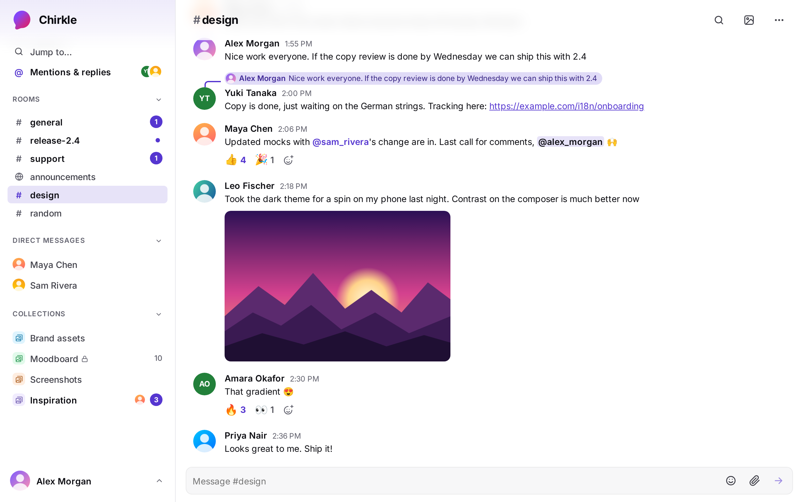
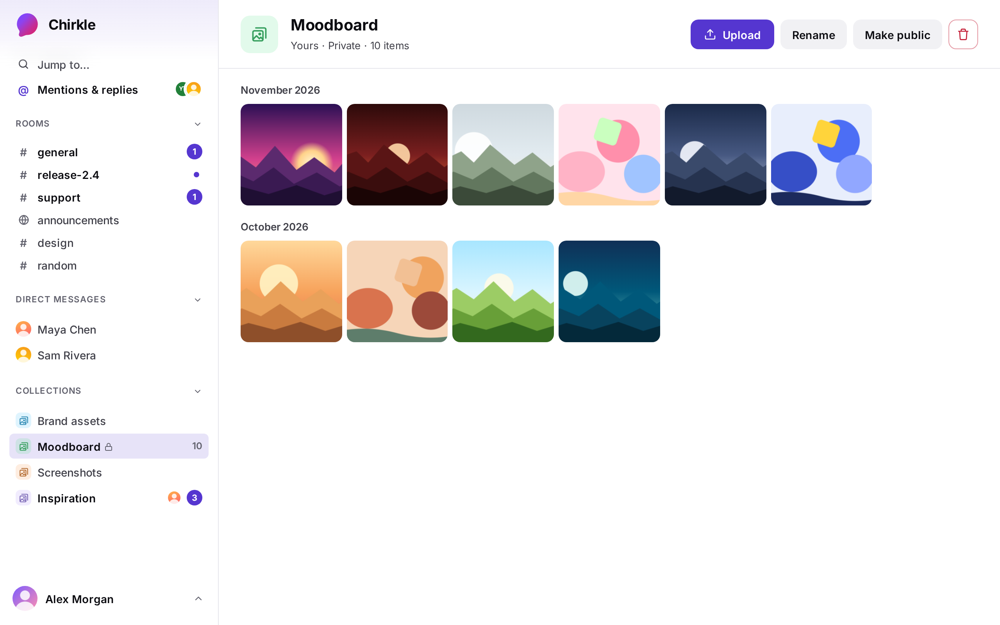

#  Chirkle

A small, fast, real-time group chat. One [PocketBase](https://pocketbase.io) binary is the whole backend
(auth, data, realtime, static files); the frontend is vanilla TypeScript bundled by esbuild — no framework,
~50 KB of JS and ~11 KB of CSS gzipped (`npm run build` fails over its budget: 62.5 KB for everything a visit loads
first, 16 KB for any rarer screen, such as the image viewer, search, room access, collections, the emoji picker and
Mentions & replies, which load on first use).

<picture>
  <source media="(prefers-color-scheme: dark)" srcset="docs/screenshot-dark.png">
  
</picture>

- Runs on a $5 VPS (1 vCPU, 1 GB of RAM): about 1,000 people online at a normal pace (2,000
  with slow sends), or 300 chatting nonstop, and 1,000 reconnecting at once catch up within seconds; beyond that it
  slows down but stays within its memory (measured, [PERF.md §13](docs/PERF.md#13-2026-11-12-one-serialization-per-answer-less-gc),
  [§14](docs/PERF.md#14-2026-11-12-memory-under-overload-admission))
- Public rooms anyone can create; hide rooms you don't care about; creators archive rooms (read-only, history kept)
- Room access, chosen by each room's creator: **Private** (only the people they add), **Public** (everyone with an account) or **Open Air** (anyone can read it, no account needed; the home page shows these rooms to guests, who log in or sign up to join in); and who can post: everyone who can read it, or only the people they choose (the others read and react)
- Live messages, edits and deletes (deleted messages leave a placeholder)
- Full history: scroll back to the very first message of any room (windowed, ≤300 messages in the DOM)
- Direct messages between any two users, private to them; close a conversation and it comes back on the next message
- Avatars (or colored initials) and a profile page to change your picture, display name (unique) and password, and to log out
- Search in any room or DM: every word you type, in any case ("привет" finds "Привет"), newest first; pick a result to go to it, however far back
- Replies: answer any message with a quote of it; click the quote to jump to the original, however far back
- Handles and @mentions: everyone has an @handle (made from their name, changeable in Settings); type "@" in the
  composer to pick someone. A message that mentions you is highlighted and notifies you like a reply, and rooms with
  unread mentions or replies show an "@" by their count
- Mentions & replies: one page, right under Jump to, of every mention of you, reply to you and reaction to your
  messages, newest first; each opens its message in its room
- Links in messages are clickable and open in a new tab (http, https and www. addresses only)
- Emoji: a picker in the composer with search by name, ":name" suggestions as you type, and reactions on any message
  (as many different ones as you like), live for everyone
- Attachments: up to 10 files of 20 MB per message, with an upload progress bar; images shown as thumbnails and videos as their first frame (4 tiles, then "+N"); files open by a link that can't be guessed, and stops working when the message is deleted
- Image viewer: click a thumbnail to see it full size (or a video to play it) and step through the room's images and videos (buttons, arrow keys, swipe);
  loaded only when first used, so it adds nothing to the page's first load
- Collections: save any image or video from the chat to collections of your own, public or private, and attach from them to messages; subscribe to other people's public collections to use theirs too, with a count of what's new and the new items highlighted; media attached from a collection link to it (or say "Private collection")
- Select messages (up to 50): forward them to any room or DM, with "Forwarded from" and their attachments (forwards show the original, so nothing is copied), or delete them together when they are yours
- Unread counts on every room and DM, live, and in sync across your tabs and devices; the total shows in the tab's favicon and title;
  a room with unread messages opens at the first of them, under a "New" line
- What you were typing is kept per room, even across a reload; "Jump to latest" whenever you are scrolled up
- Invite links for private rooms: share one link that adds whoever opens it (after logging in or signing up) as a
  member; it works for 1, 7 or 30 days and can be revoked or replaced at any time (web and Android)
- Moderators, chosen by the admin: they delete anyone's messages, change any room's access, archive rooms, and ban or
  unban people (a banned account can't log in); DMs and private rooms they aren't in stay out of their reach
- Usage statistics at `/stats` for moderators and the admin: people online now, messages and active people over
  time, no names (the admin can turn collecting them off)
- Anonymous rooms, set by the admin: messages show the room's name instead of their authors
- Your own branding (title and logo) and, if you like, invite-only signups: set by the admin in PocketBase
- Forgot password: once the admin sets up email, "Forgot password?" on the login page (web and Android) emails a link
  that sets a new password and logs out every device
- Telegram bridge (optional): link rooms to Telegram groups through a bot; messages, replies, edits, files and (with the bot an admin) reactions go both ways (deletes from Chirkle to Telegram), Telegram people show under stand-in accounts with their names and pictures — see [the Telegram bridge](https://chirkle.com/docs/telegram/)
- Fast room switching: each room's latest messages are kept in the browser (IndexedDB) and shown at once while the
  server answers; unread rooms are fetched ahead. Attachment thumbnails are kept by the service worker, so going back
  to a room (or reloading) doesn't download them again. All of it is cleared on logout
- Notifications of DMs and replies to you, with a pop-up and/or a sound, turned on in your profile, and of every
  message in the rooms you choose from their menu: they come from the open tab's live connection (even in the
  background), so no push service (Google, Mozilla, Apple) is involved
- Installable as an app (PWA: Add to Home Screen, the browser's Install button); it opens offline to its shell
- Optimistic sending with safe retries, reconnect gap-fill, light/dark themes, works on phones
- A native Android app (Kotlin, Jetpack Compose) with the same features, notifications and a 3 MB download — see
  [the Android app](https://chirkle.com/docs/android/)

<picture>
  <source media="(prefers-color-scheme: dark)" srcset="docs/collections-dark.png">
  
</picture>

**Documentation: [chirkle.com/docs](https://chirkle.com/docs/)**: installing and deploying, the user guide, administration, the
Android app, linked servers, the Telegram bridge and the configuration reference.

Design: [`docs/DESIGN.md`](docs/DESIGN.md) · Android app: [`docs/ANDROID.md`](docs/ANDROID.md) · QA: [`docs/QA.md`](docs/QA.md) · Refactoring plan: [`docs/REFACTOR.md`](docs/REFACTOR.md) · Archived plans: [MVP build](docs/history/BUILD_PLAN.md), [avatars, DMs, attachments](docs/history/NEXT_FEATURES_PLAN.md)

## Requirements

- Node.js ≥ 22 and npm ≥ 11
- Linux or macOS (x64/arm64) — `npm start` and `npm run setup` download the matching PocketBase binary (Windows: WSL or Docker)
- Optional, for the server's workers: `ffmpeg` (video posters) and `curl` (link previews) on the `PATH`
- For e2e tests: Playwright's Chromium (`npx playwright install chromium`)

## Quick start

```sh
npm install
npm start          # builds the web app, downloads PocketBase on the first run, serves http://127.0.0.1:8090
```

Or without a clone, from npm (the package ships the built web app and the server's hooks and migrations):

```sh
npx chirkle                     # data in ./pb_data
npx chirkle chat.example.com    # HTTPS with Let's Encrypt on ports 80/443
```

Open the page and sign up. The first run prints a link to create the admin (superuser) account, or create one with
`npx chirkle superuser upsert you@example.com <password>` (`npm start -- superuser upsert …` in a clone).
`HOST` and `PORT` choose the address (default `127.0.0.1:8090`; `HOST=0.0.0.0` to reach it from other machines),
`CHIRKLE_DATA` the data directory (default `./pb_data`), and any other `pocketbase serve` flags can follow
(`npx chirkle --http=0.0.0.0:80`). Every setting is in the [configuration reference](https://chirkle.com/docs/reference/configuration/). The package ships the server built for Linux and macOS (x64, arm64): no Go or PocketBase download
needed.

## Getting started (development)

```sh
npm ci
npm run setup      # builds the server (server/: PocketBase with Go hooks) into bin/chirkle-server; needs Go 1.27+
npm run dev        # esbuild watch + the server on http://127.0.0.1:8090
```

Open http://127.0.0.1:8090 and sign up (top right). The dev database lives in `pb_data/` — delete it to start over.
The PocketBase admin UI is at http://127.0.0.1:8090/_/ (create a superuser with
`bin/chirkle-server superuser upsert you@example.com <password> --dir=pb_data`).

## Scripts

| Script | What it does |
|---|---|
| `npm start` | Production build, then the server (`scripts/start.mjs`, the package's `chirkle` command): PocketBase on http://127.0.0.1:8090 with `pb_data/` |
| `npm run dev` | Unminified watch build into `pb_public/` + `pocketbase serve --dev` |
| `npm run build` | Production build (hashed assets) into `pb_public/`; fails if over the size budget |
| `npm run release -- <version>` | Gives the npm package and the Android app the next version and starts the app's changelog; then publish a GitHub Release tagged `v<version>` ([Releasing](#releasing)) |
| `npm run typecheck` | `tsc` (strict) for the frontend, tests and scripts, plus `pb_hooks/` + `pb_migrations/` against PocketBase's generated types (`types/pocketbase.d.ts`, written by `scripts/pb-types.sh`) |
| `npm run lint` | Biome: formatting, lint rules, import order (`npm run format` applies the fixes) |
| `npm run lint:sinks` | Fails if frontend code uses `innerHTML` & co. (XSS guard) |
| `npm test` | Unit tests (Vitest + happy-dom, no server) and component tests (views and services against a real, throwaway PocketBase) |
| `npm run test:unit` | Only the unit tests: no server, ~10 s |
| `npm run test:int` | Integration tests: schema, API rules, hooks, realtime, pagination |
| `npm run test:e2e` | Playwright end-to-end tests against the production build |
| `npm run schema:snapshot` | Rewrite `docs/schema.snapshot.json` (every collection's API rules, fields and indexes, and the rate limits) after a migration changes them; `test:int` fails while it is out of date |
| `npm run screenshots` | Rewrite the README screenshots (`docs/screenshot-*.png`, `docs/collections-*.png`): a throwaway server with made-up people, messages and collections, photographed in Chromium after `npm run build` |
| `npm run check` | typecheck + lint + lint:sinks + test + test:int + build (what CI runs before e2e) |
| `npm run doctor` | Is this machine ready for the tests? Go, the server binary, ffmpeg, versitygw, free space in `TMPDIR`, stray test servers, free e2e ports, and a browser that starts and draws text (`-- --browsers=chromium,firefox,webkit`). The e2e setup runs it first |

Every test run starts its own PocketBase on a free port with a temp data dir — nothing to clean up, and no fakes
except a stub Telegram Bot API for the bridge's tests. CI (`.github/workflows/ci.yml`) runs small jobs all side by side, so a failed one is re-run alone: typecheck, lint,
build, Go, unit, component, integration (3 shards), e2e (2 shards per browser: Chromium, Firefox, WebKit), the speed
check, and the Android app's lint, tests and size. A final "CI passed" job is green only when all of them are.

## Project layout

```
pb_migrations/   schema + API rules (the source of truth for access control)
pb_hooks/        server-side hooks: trimming, soft delete, edit/archive stamps, DM + unread routes, guards, security headers;
                 telegram.pb.js + telegram/: the optional Telegram bridge
web/src/         frontend: api.ts (the only module that talks to PocketBase, through pb.ts, a minimal client), router,
                 store, cache.ts (the room cache), sw.ts (the service worker), views/, lib/ (pure logic)
web/styles/      app.css (bundles app/*.css, one file per part) and viewer.css
web/public/      icons/: the logo (logo.svg) as icon.svg and the PNG app icons, served as they are
server/          the server binary: PocketBase with its JS hooks, plus the hot paths in Go (enrich, live, pages, unread)
scripts/         build, dev, build-server, pb-types (PocketBase's types for the hooks), html-sink check
tests/           unit/, integration/, e2e/, perf/ (scale measurements), support/ (PocketBase harness, Telegram stub, helpers)
android/         the Android app (docs/ANDROID.md): core/data (API, realtime, database, sync), core/ui, feature/*, app
```

## Deploying

On a Linux server with Node 22+ and a domain pointing at it, one command installs Chirkle as a systemd service that
serves HTTPS itself (Let's Encrypt, on :80/:443):

```sh
sudo npx chirkle install-service chat.example.com
```

The documentation covers the rest:

- [Run it on a server](https://chirkle.com/docs/deploy/): the one-command install and its options, updating, uninstalling, and running the
  server by hand
- [Docker](https://chirkle.com/docs/deploy/docker/) and [Dokku](https://chirkle.com/docs/deploy/dokku/), including running the image GitHub builds for every
  commit on `master` and following it from cron
- [Behind a reverse proxy](https://chirkle.com/docs/deploy/reverse-proxy/): nginx and Caddy examples, and `TRUSTED_PROXY`
- [Administration](https://chirkle.com/docs/admin/): branding, invite-only signups, moderators, anonymous rooms, email, backups and S3,
  rate limits, [link previews and video thumbnails](https://chirkle.com/docs/admin/previews-and-thumbnails/), metrics
- [Configuration reference](https://chirkle.com/docs/reference/configuration/): every environment variable, flag and setting in one place

## Android app

A native client for any server running Chirkle (Kotlin, Jetpack Compose), with several accounts at once on one server
or many, and notifications without Google services. Installing it, and what a server's admin can set up for it (room
links that open in the app, a minimum app version, a build for your own server):
[the Android app](https://chirkle.com/docs/android/) and [for admins](https://chirkle.com/docs/android/for-admins/).

To work on it (`android/`), you need JDK 17+ (21 recommended) and the Android SDK (`ANDROID_HOME`, or `sdk.dir` in
`android/local.properties`); Gradle fetches the rest. Its tests start the server from `bin/`, so run `npm run setup`
first.

```sh
cd android
./gradlew assembleDebug          # app/build/outputs/apk/debug: offers http://10.0.2.2:8090 (the dev server, from the emulator)
./gradlew check                  # lint, unit tests, API tests against PocketBase, UI tests on Robolectric
```

Design: [`docs/ANDROID.md`](docs/ANDROID.md). What it has of the web app's features: [`android/PARITY.md`](android/PARITY.md).

## Releasing

One version for the npm package and the Android app. `npm run release -- 0.2.0` sets it in `package.json` and
`android/app/build.gradle.kts` (versionCode + 1) and creates `fastlane/…/changelogs/<versionCode>.txt` to fill in.
Commit, push, then publish a GitHub Release with the new tag `v0.2.0`. The Release workflow
(`.github/workflows/release.yml`) checks the versions, attaches the signed APK and
stages `chirkle@0.2.0` on npm; approve it on npmjs.com (2FA) to publish it. Setup and details:
[`docs/ANDROID.md` §28.7](docs/ANDROID.md#287-one-release-for-the-app-and-the-npm-package-2026-11-08).

## Telegram integration

Link rooms to Telegram groups and channels through your own bot: messages, replies, edits and files go both ways, and
reactions too with the bot an admin. Set `TELEGRAM_BOT_TOKEN` and `TELEGRAM_WEBHOOK_URL`, add the bot to a group, and
link the group to a room in the admin UI. Setup, options and limits: [the Telegram bridge](https://chirkle.com/docs/telegram/).

## Linked instances

Chirkle servers can be paired by their admins to share rooms, public or private, and let their people DM each other.
Off by default. Setup, sharing, moderation and unpairing: [linked servers](https://chirkle.com/docs/linking/).

## License

[GNU General Public License v3.0](LICENSE) or later.
